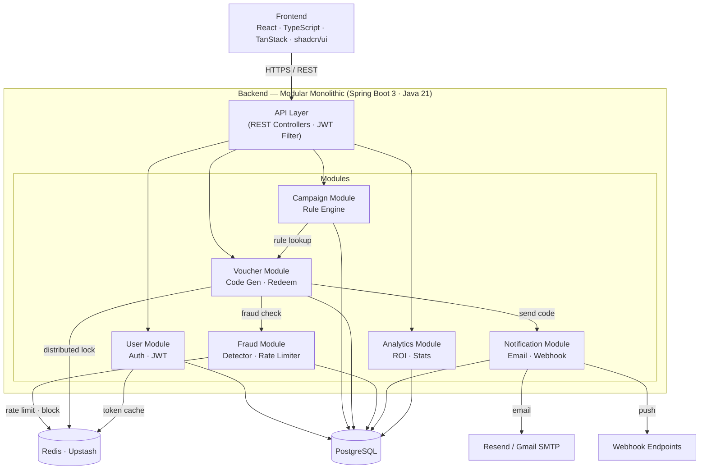
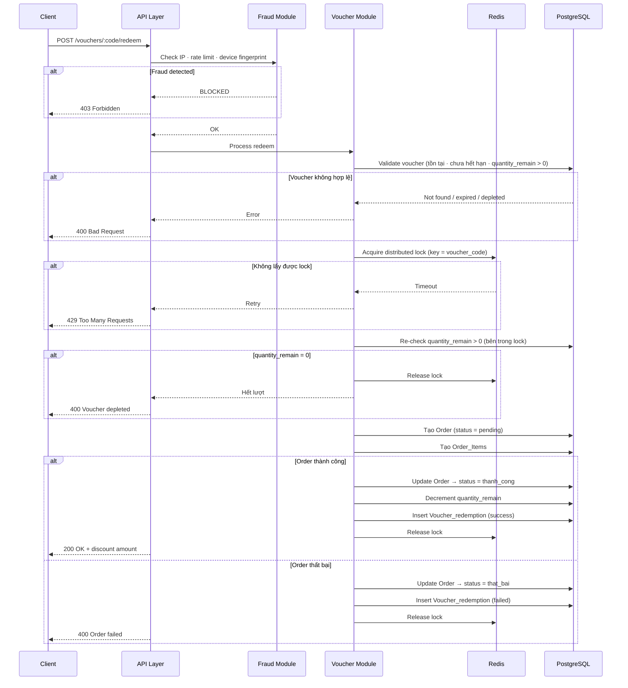
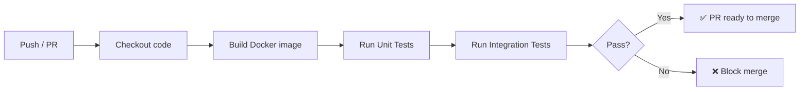
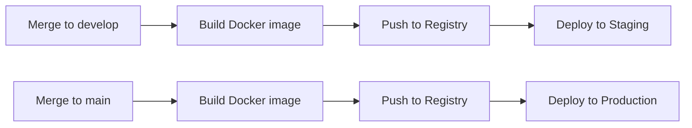

# System Architecture

## 1. Tổng quan

|                  |                                                          |
| ---------------- | -------------------------------------------------------- |
| **Kiến trúc**    | Modular Monolithic                                       |
| **Repo**         | Mono Repo                                                |
| **Backend**      | Spring Boot 3 · Java 21                                  |
| **Frontend**     | React · TypeScript · TanStack · React Router · shadcn/ui |
| **Database**     | PostgreSQL                                               |
| **Cache / Lock** | Redis (Upstash Serverless)                               |
| **Email**        | Resend / Gmail SMTP                                      |

---

## 2. Module Breakdown

| Module           | Chịu trách nhiệm                         |
| ---------------- | ---------------------------------------- |
| **User**         | Đăng nhập, xác thực JWT, phân quyền      |
| **Campaign**     | Quản lý chiến dịch, Rule Engine          |
| **Voucher**      | Sinh mã, phân phối, redeem               |
| **Fraud**        | Phát hiện gian lận, Rate Limiting, block |
| **Notification** | Gửi Email, gọi Webhook                   |
| **Analytics**    | Thống kê ROI, Redemption Rate, Dashboard |

---

## 3. Component Diagram



---

## 4. Luồng xử lý chính

### Redeem Voucher (Hot Path — 500 req/s)



### Phân phối mã

```
Admin trigger → Voucher Module → Notification Module → Email / Webhook
                                                      → Distribution_Log (DB)
```

### Dashboard

```
Client → API → Analytics Module → PostgreSQL (aggregate query)
                                → Response (≤ 5 phút cache)
```

---

## 5. Cấu trúc Mono Repo

```
promo-graud/
├── backend/          ← Spring Boot 3
│   └── src/main/java/
│       ├── module/
│       │   ├── user/
│       │   ├── campaign/
│       │   ├── voucher/
│       │   ├── fraud/
│       │   ├── notification/
│       │   └── analytics/
│       └── shared/   ← dùng chung giữa các module
├── frontend/         ← React + TypeScript
│   └── src/
│       ├── pages/
│       ├── components/
│       └── lib/
└── docs/
```

---

## 6. Môi trường

| Môi trường     | Mục đích                   | Infrastructure                      |
| -------------- | -------------------------- | ----------------------------------- |
| **Local**      | Dev từng thành viên        | Docker Compose (PostgreSQL + Redis) |
| **Staging**    | Test tích hợp, demo sprint | Railway / Render (free tier)        |
| **Production** | Nộp bài, demo giảng viên   | Railway / Render (free tier)        |

---

## 7. CI/CD Pipeline

### Công cụ

- **CI/CD:** GitHub Actions
- **Container:** Docker + Docker Compose

---

### CI — Chạy khi có PR hoặc push lên `develop`



**GitHub Actions workflow — CI:**

```yaml
# .github/workflows/ci.yml
on:
  pull_request:
    branches: [develop, main]
  push:
    branches: [develop]

jobs:
  test:
    runs-on: ubuntu-latest
    services:
      postgres:
        image: postgres:15
        env:
          POSTGRES_DB: promoquard_test
          POSTGRES_USER: test
          POSTGRES_PASSWORD: test
      redis:
        image: redis:7
    steps:
      - uses: actions/checkout@v4
      - uses: actions/setup-java@v4
        with: { java-version: "21", distribution: "temurin" }
      - name: Build & Test
        run: ./mvnw verify
```

---

### CD — Chạy khi merge vào `develop` hoặc `main`



**GitHub Actions workflow — CD:**

```yaml
# .github/workflows/cd.yml
on:
  push:
    branches: [develop, main]

jobs:
  deploy:
    runs-on: ubuntu-latest
    steps:
      - uses: actions/checkout@v4
      - name: Build Docker image
        run: docker build -t promoquard-backend ./backend
      - name: Deploy to Railway
        run: railway up
        env:
          RAILWAY_TOKEN: ${{ secrets.RAILWAY_TOKEN }}
```

---

### Git Branching Strategy

```
main          ← production · deploy khi merge từ develop
  └── develop ← staging · tích hợp tất cả feature
        ├── feature/campaign-module
        ├── feature/voucher-module
        ├── feature/fraud-module
        └── feature/analytics-module
```

| Nhánh       | Mục đích           | CI/CD                    |
| ----------- | ------------------ | ------------------------ |
| `main`      | Production         | CD → deploy production   |
| `develop`   | Staging · tích hợp | CI + CD → deploy staging |
| `feature/*` | Từng tính năng     | CI chạy khi tạo PR       |

---

## 8. Infrastructure

| Thành phần | Local                    | Staging / Production           |
| ---------- | ------------------------ | ------------------------------ |
| PostgreSQL | Docker Compose           | Railway managed DB             |
| Redis      | Docker Compose           | Upstash Serverless (free tier) |
| Backend    | `./mvnw spring-boot:run` | Docker container trên Railway  |
| Frontend   | `npm run dev`            | Docker container trên Railway  |
| Email      | Resend sandbox           | Resend / Gmail SMTP            |
